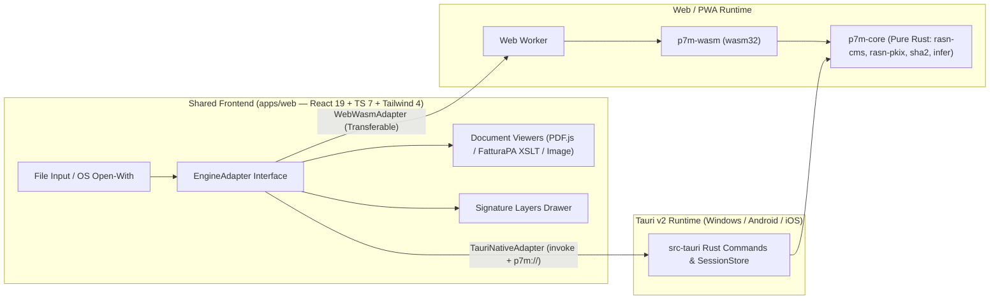

# ARCHITECTURE — ZeroP7M System Design & ADRs

## 1. System Topology (Single Core, Dual Runtime)
ZeroP7M uses a **modular monorepo** with a single Rust cryptographic/parsing core (`crates/p7m-core`) executed in two zero-server environments:
1. **WebApp / PWA Runtime:** `p7m-core` compiled to `wasm32-unknown-unknown` (`crates/p7m-wasm`), running inside a dedicated **Web Worker** with zero-copy `Transferable` `ArrayBuffer` messaging.
2. **Standalone Native Runtime (Windows / Android / iOS):** `p7m-core` linked natively into **Tauri v2 (`apps/tauri`)**, reading files directly from OS disk paths or Android `content://` URIs and streaming extracted payloads to the WebView over a custom URI protocol (`p7m://localhost/session/<uuid>`).



## 2. Monorepo Directory Layout
```text
zerop7m/
├── Cargo.toml                   # Rust workspace root
├── pnpm-workspace.yaml          # JS/TS workspace root
├── crates/
│   ├── p7m-core/                # Pure Rust engine (no_std-friendly core logic, BER/DER/PEM, X.509, local verify, MIME)
│   └── p7m-wasm/                # wasm-bindgen + serde-wasm-bindgen bridge for Web Worker
├── packages/
│   └── shared-types/            # Auto-generated TS types (ts-rs) + Zod runtime schemas + EngineAdapter interface
├── apps/
│   ├── web/                     # React 19 + Vite 8 + Tailwind 4 + PWA + PDF.js + bundled FatturaPA XSLT
│   └── tauri/                   # Tauri v2 (src-tauri/) native shell, p7m:// protocol, Windows/Android/iOS configs
├── fixtures/                    # Deterministic synthetic + anonymized Italian .p7m test corpus
├── docs/specs/                  # Single Source of Truth specifications
└── .github/workflows/           # CI (tests + audits), GitHub Pages PWA deploy, GitHub Releases (.exe + .apk + SHA256SUMS)
```

## 3. Architecture Decision Records (ADRs)

### ADR-001: `rasn` Ecosystem Over `RustCrypto/cms`
* **Decision:** Use `rasn` + `rasn-cms` + `rasn-pkix` (aligned on the same minor release, e.g. `0.30.x` or `0.29.x`).
* **Rationale:** Real Italian PA `.p7m` files frequently use ASN.1 **BER indefinite-length encoding** and constructed `OCTET STRING`s. `rasn` natively supports BER, CER, and DER in 100% safe Rust and is actively maintained in 2026, whereas `cms` (`0.2.3`, last updated Jan 2024) relies on strict DER and crashes on BER files.

### ADR-002: Tauri v2 (`2.12.6`) Over Electron / Capacitor / Flutter
* **Decision:** Use Tauri v2 for Windows, Android, and iOS-ready standalone builds.
* **Rationale:** One Rust + React codebase targets Desktop and Mobile with ~5–10 MB installers, zero bundled Chromium overhead, direct native link to `p7m-core`, and built-in Tauri `2.11+` file associations for Desktop, Android, and iOS plus `--no-sign` iOS builds.

### ADR-003: Custom URI Protocol (`p7m://`) Over JSON IPC for Binary Payloads
* **Decision:** In Tauri, `inspect_p7m_path` returns only lightweight JSON metadata (`P7MInspectionReport`) with a `sessionId`. The WebView fetches payload bytes via `p7m://localhost/session/<sessionId>`.
* **Rationale:** Serializing a 100 MB PDF as a JSON byte array over IPC causes massive RAM spikes and OOM crashes. Custom protocol streaming avoids JSON serialization entirely.

### ADR-004: Zero-Cost Distribution Model (v1.0)
* **Decision:** Distribute WebApp/PWA on GitHub Pages (or Cloudflare Pages), Windows NSIS/Portable `.exe` and self-signed Android `.apk` via GitHub Releases (+ F-Droid/Obtainium metadata), and iOS via PWA standalone + `--no-sign` source build.
* **Rationale:** Preserves 0 EUR operating cost while providing reproducible builds with `SHA256SUMS.txt` and GitHub Artifact Attestations to build user trust without paid Code Signing or store fees.

### ADR-005: Client-Side XSLT Sandboxed Rendering for FatturaPA
* **Decision:** Bundle `FoglioStileAssoSoftware.xsl` locally in `apps/web/public/assets/xsl/` and run browser-native `XSLTProcessor`, sanitizing output HTML and rendering inside `<iframe sandbox="allow-same-origin allow-modals">`.
* **Rationale:** Zero server dependency, 100% offline, minimal implementation effort (Ponytail), and strict XSS isolation.

## 4. Pinned Verified Technology Stack (November 2026)
* **Rust:** `tauri 2.12.6`, `tauri-cli 2.12.5`, `rasn`/`rasn-cms`/`rasn-pkix` (aligned `0.30.0`/`^0.29`), `sha2`/`sha1 0.11.x`, `base64 0.22.x`, `infer 0.19.x`, `wasm-bindgen 0.2.129+`, `wasm-pack 0.15.1`, `serde-wasm-bindgen 0.6.5`, `ts-rs 11.1.x+`, `rustix >= 1.1.6`.
* **Frontend:** `react`/`react-dom 19.3.1`, `typescript 7.0.2`, `vite 8.3.8`, `tailwindcss 4.3.5`, `pdfjs-dist 6.5.438`, `zod 4.6.7`, `@tauri-apps/api 2.12.5`, `vite-plugin-pwa 2.0.0`, `vitest 5.1.1`.
